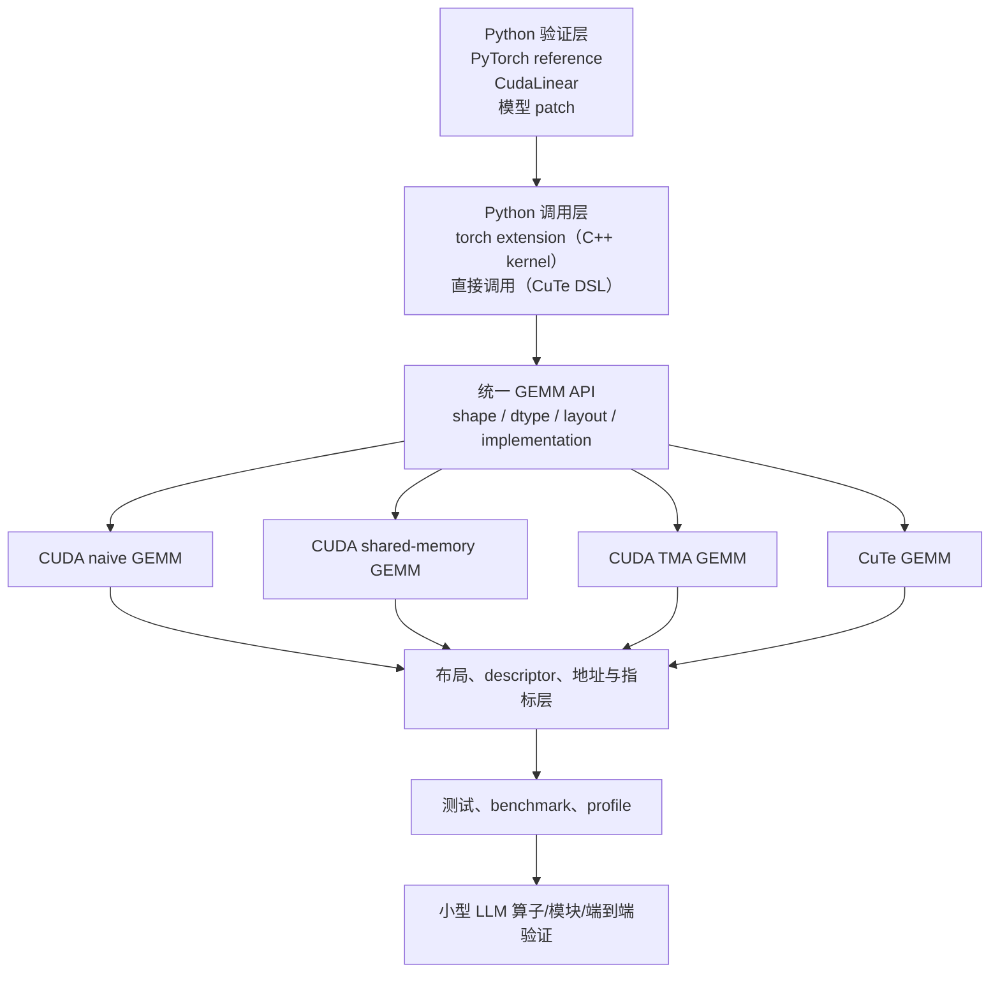

# CUDA-CuTe-TMA GEMM Lab 任务书

版本：0.5

日期：2026-11-12
项目目录：`/home/chino/project/cuda-cute-tma-lab`

## 1. 项目定义

### 1.1 项目名称

**CUDA-CuTe-TMA GEMM Lab**

### 1.2 一句话目标

用同一个 LLM GEMM 问题，依次实现 naive CUDA、shared-memory tiled CUDA、TMA 和 CuTe 四条数据路径，把通过的实现接入一个小型 LLM，完成算子级、模块级和端到端验证。

### 1.3 核心学习问题

1. CUDA 的 grid、block、warp、global memory 和 shared memory 如何共同执行一个 GEMM。
2. global memory coalescing、shared memory bank conflict 和 occupancy 如何影响性能。
3. tiled GEMM 为什么需要 shared memory、同步和边界处理。
4. TMA descriptor、logical coordinates、shared memory destination 和 mbarrier 如何共同完成 tile load。
5. CuTe 的 `Layout = (Shape, Stride)` 如何表达 tile、shared memory 和 TMA copy。
6. CuTe 如何生成或封装 TMA descriptor、坐标和 load 指令。
7. 自定义 GEMM 接入真实 LLM 线性层后，数值和性能是否保持可接受。
8. CuTe DSL 与 C++ CuTe 是什么关系：同一套布局代数，两个前端。

### 1.4 项目边界

包含：

- CUDA 基础算子：vectorAdd、row-wise RMSNorm、row-wise softmax。
- FP32、FP16、BF16 GEMM；FP8 作为后续可选扩展。
- row-major 和 column-major 布局。
- shared memory tiling、边界处理、vectorized load、register tiling。
- TMA descriptor、mbarrier、global-to-shared tile load、multi-stage pipeline。
- CuTe（Python DSL）的 `Layout`、`Tensor`、`TiledCopy`、TMA Tensor 和 GEMM。
- C++ CuTe 作为可选补充：仅在 DSL 不可用时回退使用。
- H200 和 RTX 5060 Ti 的分架构构建。
- 小型 LLM 的线性层替换、模块级验证和端到端推理验证。
- benchmark、profile、错误处理和可复现构建。

不包含：

- 完整 LLM serving 系统。
- 分布式推理、多 GPU 通信、continuous batching。
- 训练和反向传播。
- 论文专用布局或新型存储介质实验。
- 第一阶段不追求超过 cuBLAS 或 CUTLASS 官方 kernel。

### 1.5 硬件与软件目标

| 目标 | 硬件 | 架构 | 用途 |
|---|---|---|---|
| `local-sm120` | RTX 5060 Ti 8 GB | compute capability 12.0 | CUDA 基础、正确性、小规模 benchmark |
| `h200-sm90` | H200 | compute capability 9.0 | 离线批次：较大矩阵、分架构复跑 |
| `h200-sm90a` | H200 | Hopper 架构特性 | 离线批次：Hopper WGMMA 路径 |

本地当前信息（2026-11-12 实测）：

- GPU：NVIDIA GeForce RTX 5060 Ti
- compute capability：12.0
- 显存：8151 MiB
- CUDA driver：580.178.04
- CUDA Toolkit：13.4.92
- CMake：4.2.3
- Ninja：1.13.2
- host compiler：GNU 15.2.0
- Python：项目虚拟环境 3.12.15，pytest 9.2.0
- GPU 理论显存带宽：448 GB/s（128-bit GDDR7）

P0 的本地工程骨架已经建立。仍需完成版本锁定、CUTLASS/DSL 版本验证、
容器与 H200 上机 runbook。

## 2. 项目架构



### 2.1 分层职责

| 层 | 职责 |
|---|---|
| Python 验证层 | PyTorch reference、模型加载、CudaLinear、prompt 和 logits 对比 |
| 绑定层 | 将 PyTorch tensor 和 C++ GEMM API 连接；CuTe DSL 路径不需要绑定 |
| GEMM API 层 | 统一 problem 描述、dtype、layout、实现选择和错误处理 |
| Kernel 层 | naive、shared、TMA（CUDA C++），CuTe（Python DSL） |
| 布局与 TMA 层 | row/column layout、packing、TMA descriptor、swizzle、坐标 |
| 指标层 | 时间、TFLOPS、effective bandwidth、occupancy、错误统计 |
| 验证层 | correctness、profiling、LLM 输出一致性和性能 |
| 构建层 | CMake、CUDA architecture、CUTLASS（可选）、Docker；DSL 走 pip 安装 |

### 2.2 统一 GEMM 约定

数学定义：

```text
C[M,N] = A[M,K] * B[K,N]
```

PyTorch `nn.Linear`：

```text
Y[M,N] = X[M,K] * W[N,K]^T + bias[N]
```

`CudaLinear` 必须显式处理 `W` 的转置、layout 和对齐要求，不能默认 `W` 已经是 `[K,N]`。

### 2.3 实现选择

```text
implementation = naive | shared | tma | cute
layout         = row | column
dtype          = fp32 | fp16 | bf16
```

`cute` 指 CuTe Python DSL（`nvidia-cutlass-dsl`）；C++ CuTe 仅在回退时使用。

所有实现必须共享同一 problem 描述、参考输出和 benchmark 接口。

## 3. 文件组织

### 3.1 当前落地结构

项目按实现方案组织顶层目录。目录编号表示方案分类，不替代任务阶段编号：
P2 对应 `1_basic_gemm`，P3 对应 `3_tma_gemm`，P4 对应 `2_dsl_gemm`。
建议学习顺序为 `0_introduction -> 1_basic_gemm -> 3_tma_gemm -> 2_dsl_gemm`，
这样先理解手写 TMA，再理解 DSL 如何封装布局和 copy。

```text
cuda-cute-tma-lab/
  CMakeLists.txt
  CMakePresets.json
  pyproject.toml
  TASKBOOK.md
  README.md

  0_introduction/
    examples/                 # 现有入门实验
    tests/test_add_smoke.cu
    CMakeLists.txt
    README.md

  1_basic_gemm/
    include/ccg/basic_gemm.hpp
    src/gemm_naive.cu
    tests/test_gemm_naive.cu
    bench/bench_gemm.cu
    CMakeLists.txt
    README.md

  2_dsl_gemm/
    src/dsl_gemm/layout_reference.py
    tests/test_layout_reference.py
    tests/test_dsl_environment.py
    README.md

  3_tma_gemm/
    tests/test_tma_descriptor.cu
    bench/README.md
    CMakeLists.txt
    README.md

  notes/
  scripts/run_tests.sh
```

组织规则：

- 每个方案目录自带 `README.md` 和 `tests/`。
- 方案之间不共用同一组 source/test 文件，避免实现和测试混在一起。
- CUDA 方案使用各自的 `CMakeLists.txt` 和 CMake target。
- CuTe DSL 方案使用 Python 测试，不进入 CUDA CMake target。
- 根 `CMakeLists.txt` 只负责公共语言标准、CUDAToolkit 和子目录入口。
- 根 `CMakePresets.json` 提供 `local-sm120`、`h200-sm90` 和 `h200-sm90a`
  的配置入口。
- `scripts/run_tests.sh` 统一执行 CTest 和 Python DSL 测试。
- 当前 `1_basic_gemm` 只提供 naive 基线；shared tiled、register tiled
  继续放入同一阶段目录，但使用独立源文件和测试。
- 当前 `3_tma_gemm` 只提供 descriptor smoke test；TMA load、mbarrier、
  pipeline 和性能测试继续放入该目录。
- 当前 `2_dsl_gemm` 先提供 Python Layout 参考实现和 DSL 可用性检查，
  实际 CuTe DSL kernel 后续加入。

### 3.2 后续扩展规则

- 公共测试数据、容差和 benchmark 报告放入已有的方案目录，不再建立根级
  `tests/` 或根级 `src/`。
- 需要跨方案共享的 C++ 工具放入 `include/ccg/`；只属于某个实现的代码
  留在该方案目录。
- 生成结果放入 `artifacts/`，不提交大型二进制。
- 每个 kernel 的架构限制写入对应目录的 README 和 CMake target。
- 一个 kernel 文件只负责一种主要加载机制。
- CuTe DSL 文件不进入 CMake 构建，由 pip 安装的 `nvidia-cutlass-dsl` 运行。

## 4. 构建与运行目标

### 4.1 CMake Presets

| Preset | `CMAKE_CUDA_ARCHITECTURES` | 用途 |
|---|---|---|
| `local-sm120-debug` | `120` | 5060 Ti 调试 |
| `local-sm120-release` | `120` | 5060 Ti benchmark |
| `h200-sm90-release` | `90` | H200 通用 kernel 和基础 TMA |
| `h200-sm90a-release` | `90a` | Hopper WGMMA 专用路径（C++ 回退时用） |

规则：

- 通用 kernel 不依赖 Hopper WGMMA。
- 使用 Hopper 专用指令的 kernel 单独建立 target。
- 不把 `sm_120` 的二进制复制到 H200。
- Docker 只打包 toolkit、依赖和源码；GPU driver 由宿主提供。
- CuTe DSL 不参与 CMake preset，用 `pip install nvidia-cutlass-dsl` 安装，版本随 P0-03 锁定。

### 4.2 版本锁定

项目开始时固定：

- CUDA Toolkit
- CUTLASS commit
- CuTe DSL 版本（`nvidia-cutlass-dsl`）
- PyTorch 版本
- Python 版本
- CMake 和编译器版本
- 容器基础镜像 digest

### 4.3 本地轨道与 H200 轨道

H200 的使用方式是「打包容器 → 现场拷贝 → 批量执行 → 带回结果」，不是交互式开发环境。因此项目分两条轨道：

- **本地轨道（sm_120）**：日常开发、调试、正确性验证、小规模 benchmark。绝大部分工作在这里完成。
- **H200 轨道（sm_90 / sm_90a）**：只做本地做不了的事，一次上机跑完，结果文件带回。

规则：

- **H200 上不写代码、不调试。** 任何问题必须先在本地复现；现场只运行脚本、收日志。
- 镜像构建时就把 `sm90` 和 `sm90a` 二进制编译好（`nvcc` 交叉编译不需要 Hopper 显卡），现场不编译。
- 镜像内预置：CUDA Toolkit、CUTLASS、`nvidia-cutlass-dsl` wheel、Python 依赖、预编译二进制、全部源码。现场无网络。
- 结果统一写入挂载目录，按 `artifacts/h200/<日期>-<commit>/` 归档，本地再跑 `summarize.py`。
- 每次上机前本地必须全绿；上机脚本是一条命令跑完全部 H200 任务。

各阶段对 H200 的依赖：

| 阶段 | 本地能否完成 | H200 必需项 |
|---|---|---|
| P0 | 是 | 只验证镜像能 load、`nvidia-smi` 正常 |
| P1 | 是 | 无 |
| P2 | 是 | 无（cuBLAS 对照本地也有） |
| P3 | 是（sm_120 支持 TMA） | `sm90a` WGMMA、超出 8 GB 的矩阵 |
| P4 | 是 | `sm90a` 专用 atom |
| P5 | 大部分 | 大矩阵扫描（显存受限时） |
| P6 | 0.5B 模型 | 1.5B 或更大 batch |
| P7 | 部分 | 分架构完整复跑（验收要求） |

若 H200 长期不可用：P0–P6 仍可在本地跑完，P7 的分架构验收标注为「未完成」，不能把本地结果当成 H200 实测。

## 5. 接口契约

### 5.1 C++ GEMM API

```cpp
enum class DType { F32, F16, BF16 };
enum class LayoutKind { RowMajor, ColumnMajor };
enum class GemmImpl { Naive, Shared, TMA, CuTe };

struct GemmProblem {
  int M;
  int N;
  int K;
  DType dtype;
  LayoutKind layout;
};

struct GemmBuffers {
  const void* A;
  const void* B;
  void* C;
};

struct GemmResult {
  bool ok;
  double milliseconds;
  double tflops;
  double effective_bandwidth_gbps;
  std::string error;
};
```

### 5.2 Python `CudaLinear`

接口要求：

- 支持 inference forward。
- 记录原始 shape、layout、dtype 和对齐要求。
- 对不支持的 shape、dtype、alignment 回退到 PyTorch。
- 回退时必须记录原因，不能静默回退。
- 必须能选择 reference 或 custom implementation。

建议接口：

```python
class CudaLinear(torch.nn.Module):
    def __init__(self, in_features, out_features, bias=True,
                 implementation="cute", layout="column"):
        ...

    def forward(self, x):
        ...
```

### 5.3 CLI

```text
gemm_lab --M 512 --N 4096 --K 4096 --dtype bf16 \
         --layout column --impl shared --warmup 20 --iterations 100
```

输出：

- 正确性校验结果
- 中位数和 p95 时间
- TFLOPS
- effective bandwidth
- kernel 名称
- GPU 名称和 compute capability
- git commit

## 6. 测试形状和基准

### 6.1 正确性形状

覆盖：

```text
M, N, K ∈ {1, 7, 31, 64, 127, 128, 129, 256, 1024}
```

边界测试：

- `M=1` 的 decode 场景。
- 非 2 的幂 shape。
- `K` 不是 tile 尺寸整数倍。
- 非对齐指针。
- 非连续输入。

### 6.2 性能形状

建议基准：

```text
decode 类：M=1,   N=4096, K=4096
prefill 类：M=512, N=4096, K=4096
tile 类：  M=128, N=256, K=4096
```

每个 benchmark 使用固定随机种子，warmup 后取中位数和 p95。

### 6.3 数值容差

容差写入 `tests/reference/tolerances.yaml`，必须在优化 kernel 之前确定。

每个 dtype 至少记录：

- max absolute error
- relative L2 error
- cosine similarity
- NaN/Inf 数量

不能通过事后放宽容差让测试通过。

## 7. 任务计划

### 阶段 P0：工程基础

#### P0-01 建立仓库骨架

- 交付：目录、CMake、`.gitignore`、README、基础测试入口。
- 验证：空项目可以 configure 和 build；`ctest` 可以运行。

#### P0-02 建立本地与 H200 构建矩阵

- 交付：CMake presets、`local-sm120`、`h200-sm90`、`h200-sm90a`。
- 验证：所有 preset 能完成 configure；H200 上能编译并运行一个空 CUDA kernel；本地 5060 Ti 能运行对应 `sm120` 版本。

#### P0-03 固定 CUDA、PyTorch 和 CUTLASS 版本

- 交付：版本清单、CUTLASS commit、Dockerfile。
- 验证：在 H200 容器中运行 `nvidia-smi`、编译最小 kernel、运行 PyTorch CUDA tensor 加法、`import cutlass.cute` 并打印版本。

#### P0-04 建立测试和 benchmark 输出格式

- 交付：JSON/CSV schema、环境信息字段、失败状态约定。
- 验证：测试脚本能生成包含 GPU、架构、commit、shape、dtype、实现名称的报告。

#### P0-05 容器与上机 runbook

- 交付：`docker/Dockerfile`（构建时预编译 `sm90`/`sm90a` 二进制）、`docker/build.sh`、`docker/run_h200.sh`、一份上机清单。
- 验证：本地构建镜像 → `docker save` → `docker load` 复验；容器内 `nvcc --version`、`import cutlass.cute`、`ctest` 通过（无 GPU 的用例跳过）；GPU 用例在首次上机时补验。

### 阶段 P1：CUDA 基础校准

#### P1-01 vectorAdd 与 grid-stride loop

- 交付：`vectorAdd` kernel、host 调用、CUDA event 计时。
- 验证：与 CPU/PyTorch 对齐；覆盖非 grid 整数倍长度；输出 effective bandwidth。

#### P1-02 row-wise RMSNorm

- 交付：单 block 版本，支持任意行长度。
- 验证：与 PyTorch reference 对比；覆盖长行、短行、非 2 的幂长度；检查数值稳定性。

#### P1-03 row-wise stable softmax

- 交付：max、exp、sum、normalize 四步实现。
- 验证：与 PyTorch `softmax` 对比；覆盖大值、负值和极端分布；检查 NaN/Inf。

#### P1-04 Nsight Compute 基线

- 交付：记录 global load/store、shared memory、occupancy、warp stall 指标。
- 验证：为一个 memory-bound kernel 和一个 compute-bound kernel 生成 profiling 报告。

阶段门：P1 未通过时，不进入 GEMM 性能优化。

### 阶段 P2：GEMM 基线

#### P2-01 naive GEMM

- 交付：FP32/BF16 的基础版本。
- 验证：与 PyTorch FP32 reference 对比；覆盖 `1`、非 2 的幂和边界 shape。

#### P2-02 shared-memory tiled GEMM

- 交付：shared memory tile、block 同步、边界处理。
- 验证：输出与 naive 和 PyTorch 一致；记录不同 tile size 的性能。

#### P2-03 vectorized load 与 register tiling

- 交付：向量化 global load、寄存器累加、减少重复 shared memory 访问。
- 验证：同一 shape 下与 P2-02 对比；结果不变；报告中位数和 p95。

#### P2-04 cuBLAS 对照

- 交付：cuBLAS reference benchmark。
- 验证：同 shape、同 dtype、同 GPU；结果与项目 kernel 输出对齐；记录性能差距，不要求超过 cuBLAS。

#### P2-05 性能报告

- 交付：naive、shared、vectorized、cuBLAS 的对比表。
- 验证：每组至少 5 次独立运行；结果包含 warmup、中位数、p95 和峰值显存。

阶段门：P2 输出正确，且能解释每一种优化改变了哪些内存访问或同步行为。

### 阶段 P3：TMA GEMM

#### P3-01 TMA descriptor builder

- 交付：host 端 `cuTensorMapEncodeTiled` 封装和字段日志。
- 验证：打印并核对 `globalDim`、`globalStrides`、`boxDim`、dtype；与手工地址计算表一致。

#### P3-02 单 tile TMA global-to-shared load

- 交付：TMA load、mbarrier arrive/expect-tx/wait、shared memory 检查。
- 验证：加载一个 BF16/FP16 tile，与 CPU 复制的 shared memory 内容逐元素对比。

#### P3-03 TMA GEMM

- 交付：使用 TMA 加载 A/B tile 的 GEMM。
- 验证：与 P2 shared GEMM 和 PyTorch 对齐；覆盖 tile 边界和越界处理。

#### P3-04 multi-stage pipeline

- 交付：双缓冲或多阶段 pipeline。
- 验证：无 race、无死锁；与 P3-03 输出一致；Nsight 确认 copy 和 compute 有重叠。

#### P3-05 TMA descriptor 边界测试

- 交付：对齐、stride、box 尺寸、越界填充和非法参数测试。
- 验证：非法参数必须返回明确错误；合法边界 case 与参考实现一致。

#### P3-06 TMA 性能报告

- 交付：TMA 与 shared-memory GEMM 对比。
- 验证：记录本地和 H200 上的时间、TFLOPS、shared memory 使用量和 occupancy（H200 数据可批次补测）；不以超过 cuBLAS 作为通过条件。

阶段门：P3 必须在本地 sm_120 上跑通，且能指出每次 TMA load 的 descriptor、坐标、shared memory 目标地址和 barrier。H200 上的 `sm90a` 复跑单独记录。

### 阶段 P4：CuTe GEMM（Python DSL）

本阶段用 CuTe Python DSL 实现，不写 C++ 模板，不进入 CMake 构建。P3 的手写 TMA 是独立阶段，同时可作为 P4 的对照基准。

#### P4-00 验证 DSL 与目标架构

- 交付：安装 `nvidia-cutlass-dsl`，跑通自带 examples 里的最小 GEMM。
- 验证：本地 `sm_120` 和 H200 `sm_90` 都能编译并运行。
- 若不支持 `sm_120`：回退 C++ CuTe（`sm_120a` target），或仅用 DSL 学布局代数（`make_layout`、`print_layout` 不需要 GPU），GEMM 部分退回 C++。这个判断必须在写业务代码之前做完。

#### P4-01 CuTe Layout 与 Tensor 基础

- 交付：若干 `make_layout`、`make_tensor`、slice 和 composition 示例，用 `print_layout` 打印结果。
- 验证：手算的 `(Shape, Stride)` 地址与 CuTe 输出一致。

#### P4-02 CuTe tiled copy

- 交付：用 CuTe 表达 shared memory load/copy。
- 验证：shared memory 内容与 P3 手工 TMA 版本一致。

#### P4-03 CuTe DSL GEMM

- 交付：在本地 `sm_120` 上运行 CuTe DSL GEMM；H200 作为批次复跑。
- 验证：输出与 P2/P3 和 PyTorch 对齐；记录 DSL 版本、目标架构和 JIT 编译时间。

#### P4-04 手写 TMA 与 CuTe 对照

- 交付：代码、性能和行为差异说明。
- 验证：同 shape、同 dtype 下输出一致；报告 descriptor 生成、坐标计算、调度这三层里，CuTe 各自替你做了什么。

阶段门：P4 完成后，必须能解释 CuTe 的 `Layout` 如何生成 TMA descriptor 和 load 坐标。

### 阶段 P5：性能优化与对照

#### P5-01 shared memory swizzle

- 交付：不同 swizzle 模式或手写 bank-conflict 处理。
- 验证：输出不变；用 Nsight 验证 bank conflict 指标改善或解释未改善原因。

#### P5-02 tile shape sweep

- 交付：对 `M/N/K`、tile 尺寸、block 尺寸进行参数扫描。
- 验证：生成表格和曲线；每个配置有正确性检查；不允许只记录更快但错误的配置。

#### P5-03 pipeline depth sweep

- 交付：不同 stage 数量的测试。
- 验证：无错误、无死锁；报告延迟、吞吐和 shared memory 使用量。

#### P5-04 TMA 与 CuTe 的代码生成对照

- 交付：同一 GEMM 的手写 TMA 与 CuTe 版本对照文档。
- 验证：相同输入输出一致；能指出 CuTe 隐式生成的 descriptor、坐标和 copy 行为。

#### P5-05 优化结果报告

- 交付：naive、shared、TMA、CuTe 的完整对比。
- 验证：所有结果有固定 shape、dtype、GPU、commit 和重复次数；结论不超出测量范围。

### 阶段 P6：LLM 接入与验证

#### P6-01 小模型与 reference 准备

- 交付：固定模型名称、revision、dtype、prompt、随机种子和 PyTorch reference 输出。
- 验证：在本地 5060 Ti 上可运行 0.5B–1.5B BF16 或 4-bit 小模型；保存 logits 和 token。

#### P6-02 `CudaLinear` 接入

- 交付：C++ kernel 走 torch extension；CuTe DSL kernel 直接从 Python 调用，不需要 pybind11。两者共用同一个 Python wrapper、layout 适配和 fallback。
- 验证：随机 shape 和真实模型层 shape 与 PyTorch `nn.Linear` 对比；记录误差和不支持 case。

#### P6-03 单层替换

- 交付：替换一个 FFN projection 或 attention projection。
- 验证：hidden state、logits、top-1/top-k 与 reference 对比；统计误差。

#### P6-04 支持层全量替换

- 交付：按支持矩阵替换模型中的线性层。
- 验证：固定 prompt、greedy decoding；比较 logits 和生成 token；记录回退层数量和原因。

#### P6-05 端到端性能测试

- 交付：TTFT、prefill latency、decode tokens/s、峰值显存。
- 验证：与 PyTorch 和 cuBLAS 基线对比；本地 local-sm120 必须跑，h200-sm90 作为批次复跑；结果按硬件分开报告。

阶段门：P6 必须在真实模型权重和真实 prompt 上运行；仅合成矩阵通过不算 LLM 验证。

### 阶段 P7：验收与归档

#### P7-01 文档完成

- 交付：架构、CUDA、TMA、CuTe、LLM 验证、结果文档。
- 验证：另一台机器按照 README 可以完成 configure、build、test 和最小 benchmark。

#### P7-02 复现实验

- 交付：固定 commit、版本清单、Docker 镜像、benchmark 命令。
- 验证：本地 sm120 和 H200 sm90 各执行一次完整测试；结果文件包含环境信息。

#### P7-03 最终报告

- 交付：四种 GEMM 路径的正确性、性能、地址路径和 LLM 验证结果。
- 验证：每条结论都有对应代码路径、shape、硬件和日志位置。

#### P7-04 边界声明

- 交付：明确列出 CUDA、TMA、CuTe、H200 和 5060 Ti 的能力边界。
- 验证：报告中不出现把模拟结果称为硬件实测的表述。

## 8. 最终验收标准

项目通过需要同时满足：

1. 本地 5060 Ti 和 H200 都有可复现的构建路径。
2. naive、shared、TMA（CUDA C++）、CuTe（Python DSL）四种路径至少各有一个可运行版本。
3. 所有 GEMM 实现通过固定参考和边界 shape 测试。
4. 每次 TMA load 都能说明 descriptor、坐标、shared memory 目标和 barrier。
5. CuTe 的 `Layout` 和 TMA copy 与手写地址计算一致。
6. 至少一个真实 LLM 完成算子级、模块级和端到端验证。
7. 报告区分真实 GPU 实测、软件模拟和参考数据。

## 9. 风险与处理

| 风险 | 处理 |
|---|---|
| 本地 `sm120` 与 H200 `sm90` 指令差异 | 分开 target；公共 kernel 与 Hopper 专用 kernel 隔离 |
| H200 上 WGMMA 需要 `sm90a` | 单独 preset 和 target；不混入通用 kernel |
| PyTorch 权重 shape 与 GEMM 约定不同 | `CudaLinear` 显式记录转置和 layout |
| BF16 累加差异导致 token 漂移 | 使用 logits、top-k、固定 prompt 和 greedy decoding |
| 只替换部分层导致性能不可比 | 记录替换层数、fallback 层数，分别报告 |
| CUTLASS 示例版本不兼容 | 固定 commit；先跑最小 CuTe layout，再接完整 GEMM |
| CuTe DSL 对 `sm_120` 的支持未确认 | P4-00 先验证；不支持则回退 C++ CuTe，或只用 DSL 学布局代数 |
| DSL 迭代快、API 会变 | 随 P0-03 锁定 `nvidia-cutlass-dsl` 版本，不跟随最新 |
| Windows 与 Linux 环境差异 | 源码和 CMake 跨平台；H200 使用 Linux 容器重新编译 |
| H200 只能现场拷贝、上机窗口稀缺 | 本地轨道完成绝大部分；H200 只做批次复跑，见 4.3 |

## 10. 参考资料

- [CUDA Programming Guide 4.12: Asynchronous Data Copies](https://docs.nvidia.com/cuda/cuda-programming-guide/04-special-topics/async-copies.html)
- [CUDA Driver API: Tensor Map Object Management](https://docs.nvidia.com/cuda/cuda-driver-api/group__CUDA__TENSOR__MEMORY.html)
- [CUDA Driver API: CUtensorMap](https://docs.nvidia.com/cuda/cuda-driver-api/structCUtensorMap.html)
- [CuTe Layouts](https://docs.nvidia.com/cutlass/latest/media/docs/cpp/cute/01_layout.html)
- [CuTe Tensor](https://docs.nvidia.com/cutlass/latest/media/docs/cpp/cute/03_tensor.html)
- [CuTe TMA Tensors](https://docs.nvidia.com/cutlass/latest/media/docs/cpp/cute/0z_tma_tensors.html)
- [CUTLASS CuTe tutorial examples](https://github.com/NVIDIA/cutlass/tree/main/examples/cute/tutorial)
- CuTe DSL：`pip install nvidia-cutlass-dsl`，示例在 CUTLASS 仓库的 Python examples 目录
- 本地资料索引：待补充

## 11. 建议执行顺序

```text
P0 工程基础
  -> P1 CUDA 基础
  -> P2 GEMM 基线
  -> P3 TMA（手写 descriptor、mbarrier、pipeline）
  -> P4 CuTe DSL
  -> P5 性能优化与对照
  -> P6 LLM 接入
  -> P7 验收与归档
```

按每周 8–10 小时估计，P0–P4 约 6–8 周，P5–P7 约 2–4 周。该排期是建议，不是课程或论文承诺。

## 12. 变更记录

### 0.5（2026-11-12）

- 顶层目录改为按方案组织：`0_introduction`、`1_basic_gemm`、
  `2_dsl_gemm`、`3_tma_gemm`。
- 新增根 `CMakeLists.txt`、`CMakePresets.json`、`pyproject.toml` 和
  统一测试脚本。
- 每个方案目录增加独立 `README.md`、`tests/`；CUDA 方案增加独立
  `CMakeLists.txt`。
- 增加 naive GEMM 基线、TMA descriptor smoke test、DSL Layout
  参考测试。
- 明确目录编号与 P2/P3/P4 的映射及建议学习顺序。

### 0.4（2026-11-04）

- 新增 4.3「本地轨道与 H200 轨道」：H200 只做离线批次执行，不做开发调试。
- 新增 P0-05：容器构建（预编译 `sm90`/`sm90a`）与上机 runbook。
- P3 阶段门从「必须能在 H200 上运行」改为「本地 sm_120 跑通，H200 批次复跑」。
- P3-06、P4-03、P6-05 的 H200 要求降为批次补测，本地为准。
- 1.5 表与风险表同步：H200 定位为离线批次环境。

### 0.3（2026-11-04）

- P4 改为 CuTe Python DSL 路线：`gemm_cute.cu` 换成 `python/ccg/gemm_cute_dsl.py`。
- P6-02 按实现分流：C++ kernel 走 torch extension，DSL kernel 直接调用，不再统一走 pybind11。
- 新增 P4-00：先验证 DSL 对 `sm_120` 的支持，再决定是否回退 C++ CuTe。
- 补充实测环境信息：本机缺 git、CMake、Ninja、MSVC、CUDA Toolkit、PyTorch。
- 修正项目路径、`WGMMA/WGMMA` 笔误、资料索引路径。

### 0.2（2026-11-04）

- 上一版：四条路径均为 C++ 实现。
