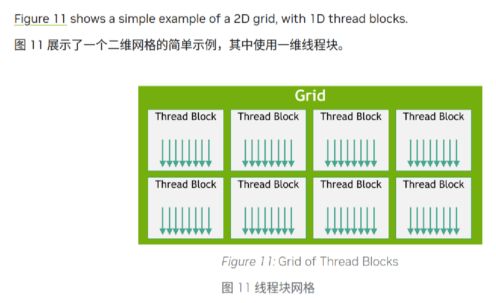
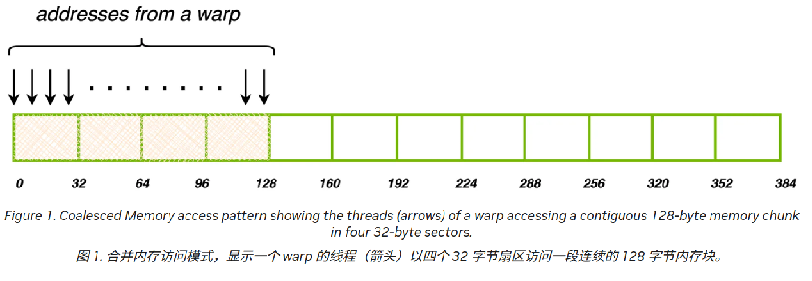
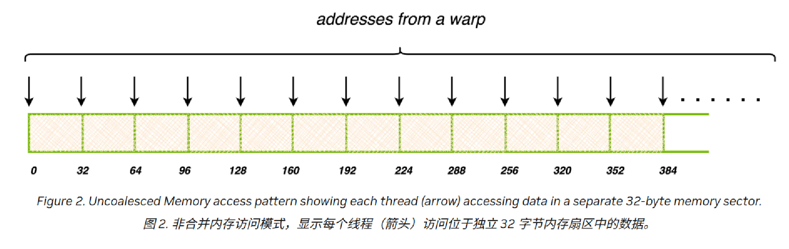
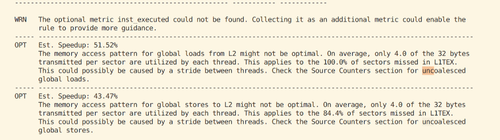
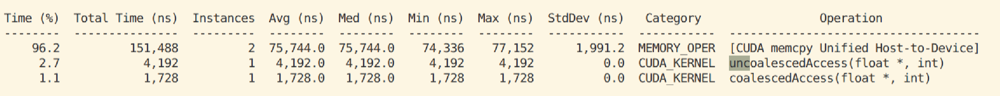
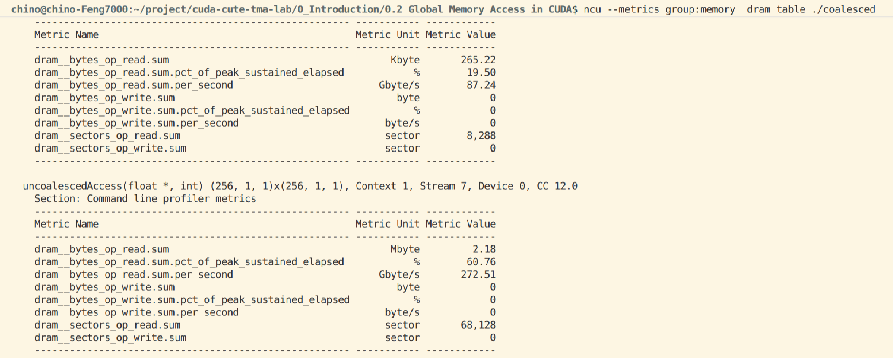
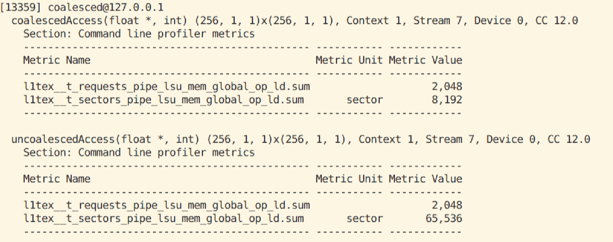
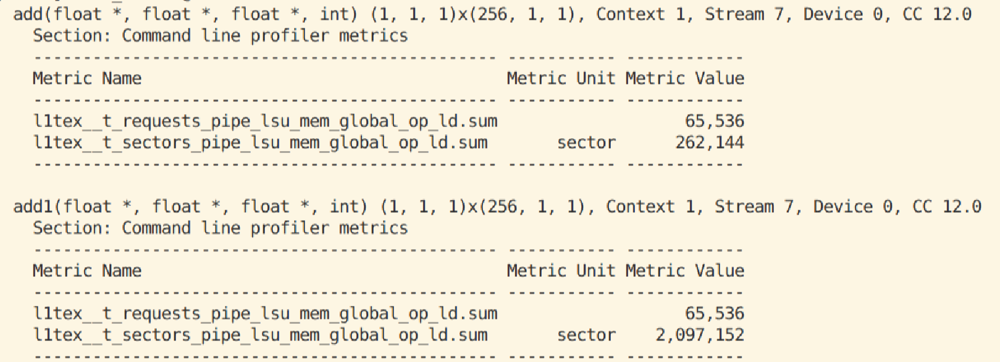

# CUDA Learning
## 0.1 An Even Easier Introduction to CUDA
任务：两个1M大小的数组相加
CPU实现：test.cpp
GPU实现：test.cu
使用cudaMallocManaged(*x)为x分配空间
使用cudaFree(*x)释放
使用add<<<para>>>(*x, *y)调用cuda kernel
kernel的定义方式：在function前面加上__global__
同步：cpu需要等待GPU完成任务后再输出，使用cudaDeviceSynchronize()

典型的GPU编程范式：分配shared mem，调用kernel，sync，释放shared mem

### profiling
使用nsys
nsys profile -t cuda --stats=true ./add_cuda

使用nsys_seasy
nsys_easy [-t trace] [-s sample] [-c ctxsw] [-o output] [-r report] command
nsys_easy ./test


### 使用Thread
<<<1,1>>>中的**后一个1**代表一个线程块中的线程数,使用的线程块大小是 32 的倍数；选择 256 个线程是一个合理的大小。
add<<<1, 256>>>(N, x, y);
但是这样修改，只会让每一个线程运行一次
threadIdx.x 包含当前线程在其线程块内的索引，
blockDim.x 包含该线程块中的线程数，需要在kernel内用这些参数

   
### 使用线程块
每个线程块都在单个SM上运行，每个SM最多支持1024个thread
<<<1,256>>>的**第一个参数**代表线程块的数量，组成了所谓的grid（网格）

gridDim.x为网格中的块数（第一个参数）
blockIdx.x为线程块在网格上的索引

网格跨步循环（grid-stride loop）将 stride 设置为网格中的线程总数（ blockDim.x * gridDim.x ）
blockdim:块大小（每个块中线程数量）
gridDim:块的数量
threadIdx：一个块中thread的索引
blockIdx：网格中block的索引

gridDim*blockDim:线程总数
blockIdx*blockDim:block的初始位置
blockIdx*blockDim+threadIdx:block中某个thread的初始位置

网格跨步循环：所有thread（block大小*block数量）处理一大块数据，一步大小为所有thread的数量


可以看到加速没有想象中的大
### 关于多维线程块
使用多维线程块和网格只是为了方便，不会影响性能。块中的线程会以可预测的方式线性化：第一个索引 x 变化最快，其次是 y ，然后是 z 。这意味着，在线程索引的线性化中， threadIdx.x 的连续值表示连续的线程， threadIdx.y 的步长为 blockDim.x ，而 threadIdx.z 的步长为 blockDim.x * blockDim.y 。这会影响线程如何分配到 warp，详见硬件多线程。


### 统一内存预取
由于CUDA虚拟内存，可以放在任意设备内存上（CPU或者GPU），因此调用时会发生多次缺页，将内存中的数据搬到显存当中，造成内存瓶颈
迁移的开销很大，因为缺页是逐个发生的，可以通过预取，将内存中的数据预先搬运到显存当中


    cudaMemLocation location{};
    location.type = cudaMemLocationTypeDevice;
    location.id = 0;  // GPU 编号，单卡填 0

    cudaMemPrefetchAsync(x,n*sizeof(float),location,0);

### 调度顺序


粒度：一个warp32个线程是同时执行的（同一个 warp 的 lane 一起执行）

## 0.2 关于global mem合并访存
| | Global Memory | Shared Memory |
|---|---|---|
| 位置 | 显卡显存，片外 | SM 片内 |
| 容量 | GB 级 | 每 block 通常几十 KB |
| 延迟 | 高，几百个周期 | 低，几十个周期 |
| 作用域 | 所有 block、所有线程 | **同一个 block 内**的线程 |
| 生命周期 | 从 `cudaMalloc` 到 `cudaFree` | block 执行期间 |
| 声明方式 | `cudaMalloc` 得到指针 | `__shared__` |
| 主要性能问题 | 是否合并访存 | 是否发生 bank conflict |
| 同步 | 跨 block 不能依赖顺序 | 常用 `__syncthreads()` |

shared mem只在SM内部共享，只在当前 block 内共享，不同 block 之间不能直接共享 shared memory；跨 block 通信还是要用 global memory、原子操作等

### global mem合并访存
global mem即是设备显存，可以被host和所有GPU线程访问
分配方式有
cudaMalloc();
cudaMallocManaged();
__device\__ float data[]

关于warp，假设一个线程块中有256个线程，每个warp有32个线程，即8个warp，SM 不会每次只取一个线程来执行，而是取一个 warp，为这个 warp 发射一条指令（SIMT，单指令多线程）。一个 SM 里可以同时驻留多个 warp，warp scheduler 会在它们之间切换。

在 CUDA 中访问全局内存时，需要考虑的一个关键方面是**同一 warp 内32个线程所访问的内存位置之间有何关系**。这些内存访问模式会直接影响内存访问效率和应用程序的整体性能。

全局内存通过 **32 字节**（称为sector）内存事务进行访问。当 CUDA 线程从全局内存请求数据时，**该 warp 中所有线程的内存访问会被合并为最少的内存事务数**。所需内存事务数取决于每个线程访问的字大小以及内存地址在各线程间的分布。
也就是说，是把各个warp请求的内存合并起来调度

意思就是，global mem的访问粒度是32B,一次最少搬运32B，而warp内的各个线程的读不是孤立的，如果落在同一个32B粒度内那就可以合并。如果地址相差太大，就会造成很明显的读放大

所谓合并访存，合并访存发生在**同一个 warp 的同一条 load/store 指令内**。硬件会看这个 warp 中所有 active lane 的地址，把它们**映射到尽量少的 sector**。不同 warp 之间不会合并。warp 内一条访存指令的地址会一起参与合并；地址集中在少量 32B sector 内时，传输量小；地址分散到很多 sector 时，虽然每个线程只需要 4B，实际却取回大量未使用的字节，形成读放大。
合并访存：

非合并访存：


### 实验
两个kernel,一个合并访存，一个不合并访存
调用ncu --section MemoryWorkloadAnalysis_Tables --print-details=all ./coalesced
可以看到，ncu已经给我们提醒了未合并访存的读放大和写放大问题




进一步分析DRAM数据：
ncu --metrics group:memory__dram_table ./coalesced

可以看到读放大为八倍

ncu --metrics l1tex__t_sectors_pipe_lsu_mem_global_op_ld.sum,l1tex__t_requests_pipe_lsu_mem_global_op_ld.sum ./coalesced

可以看到，合并访存的请求数：sector数量为1：4，因为请求按warp粒度进行，一个warp32个线程共请求32*4=128B，需要4个sector，符合预期
而不合并访存的请求数：sector数量为1：32，因为每个线程都需要读一个sector

回想之前的两种add实现：
```

__global__
void add1(float *x,float *y,float *sum, int n){
    int thread = blockDim.x;
    int index = threadIdx.x;
    int blocksize = n/thread;
    for(int i = index*blocksize;i<(index+1)*blocksize ;i++){
        sum[i]=x[i]+y[i];
    }
    
}

__global__
void add(float *x,float *y,float *sum, int n){
    int stride = blockDim.x;
    int index = threadIdx.x;
    for(int i = index;i<n ;i+=stride){
        sum[i]=x[i]+y[i];
    }
    
}
//这种方法即使块大小不为整数也正确


```

也正好对应了1：4与1：32

## 0.3 Shared memory access in CUDA
