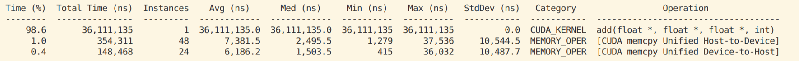
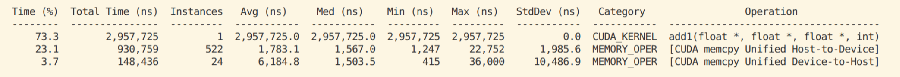
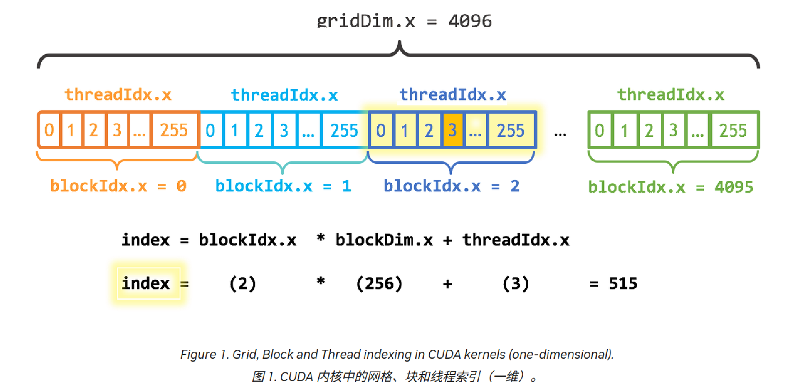
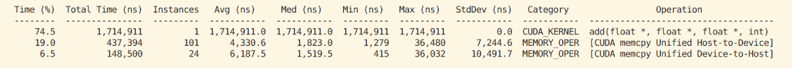
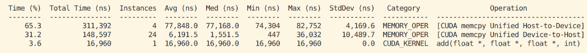
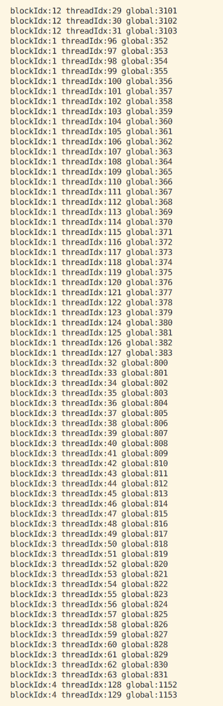

# CUDA Learning
## 0 An Even Easier Introduction to CUDA
任务：两个1M大小的数组相加
CPU实现：test.cpp
GPU实现：test.cu
使用cudaMallocManaged(*x)为x分配空间
使用cudaFree(*x)释放
使用add<<<para>>>(*x, *y)调用cuda kernel
kernel的定义方式：在function前面加上__global__
同步：cpu需要等待GPU完成任务后再输出，使用cudaDeviceSynchronize()

典型的GPU编程范式：分配shared mem，调用kernel，sync，释放shared mem

### profiling
使用nsys
nsys profile -t cuda --stats=true ./add_cuda

使用nsys_seasy
nsys_easy [-t trace] [-s sample] [-c ctxsw] [-o output] [-r report] command
nsys_easy ./test

### 使用Thread
<<<1,1>>>中的**后一个1**代表一个线程块中的线程数,使用的线程块大小是 32 的倍数；选择 256 个线程是一个合理的大小。
add<<<1, 256>>>(N, x, y);
但是这样修改，只会让每一个线程运行一次
threadIdx.x 包含当前线程在其线程块内的索引，
blockDim.x 包含该线程块中的线程数，需要在kernel内用这些参数

   
### 使用线程块
每个线程块都在单个SM上运行，每个SM最多支持1024个thread
<<<1,256>>>的**第一个参数**代表线程块的数量，组成了所谓的grid（网格）

gridDim.x为网格中的块数（第一个参数）
blockIdx.x为线程块在网格上的索引

网格跨步循环（grid-stride loop）将 stride 设置为网格中的线程总数（ blockDim.x * gridDim.x ）
blockdim:块大小（每个块中线程数量）
gridDim:块的数量
threadIdx：一个块中thread的索引
blockIdx：网格中block的索引

gridDim*blockDim:线程总数
blockIdx*blockDim:block的初始位置
blockIdx*blockDim+threadIdx:block中某个thread的初始位置

网格跨步循环：所有thread（block大小*block数量）处理一大块数据，一步大小为所有thread的数量

可以看到加速没有想象中的大

### 统一内存预取
由于CUDA虚拟内存，可以放在任意设备内存上（CPU或者GPU），因此调用时会发生多次缺页，将内存中的数据搬到显存当中，造成内存瓶颈
迁移的开销很大，因为缺页是逐个发生的，可以通过预取，将内存中的数据预先搬运到显存当中

    cudaMemLocation location{};
    location.type = cudaMemLocationTypeDevice;
    location.id = 0;  // GPU 编号，单卡填 0

    cudaMemPrefetchAsync(x,n*sizeof(float),location,0);

### 调度顺序

粒度：一个warp32个线程是同时执行的（同一个 warp 的 lane 一起执行）
